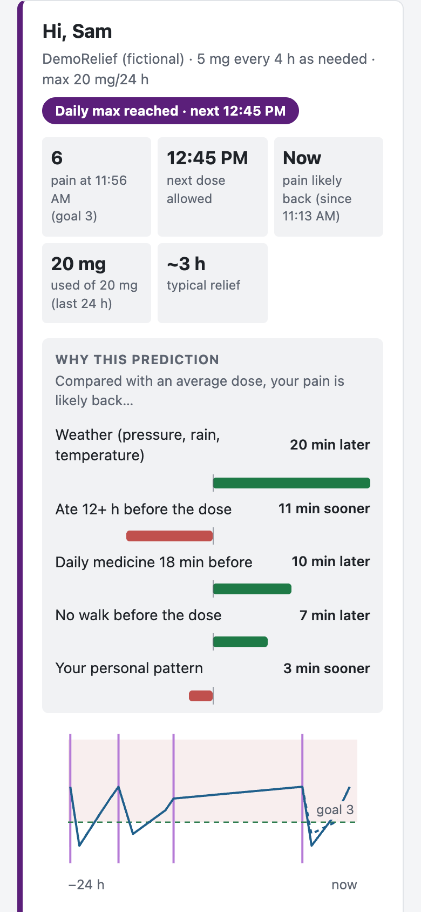
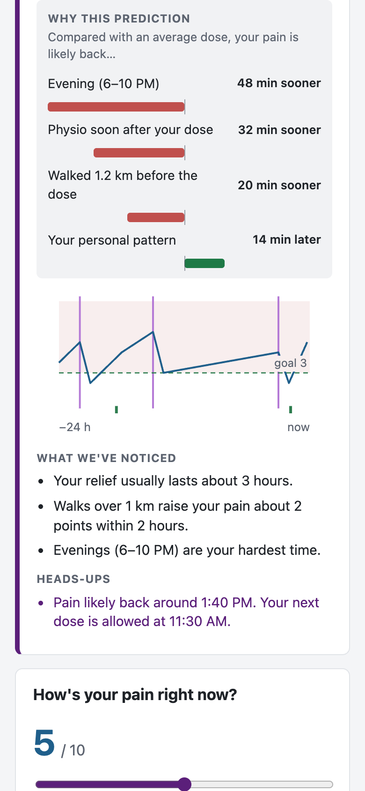
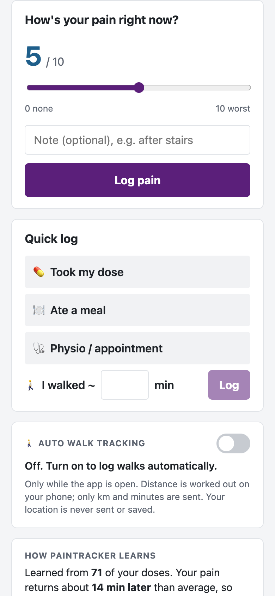
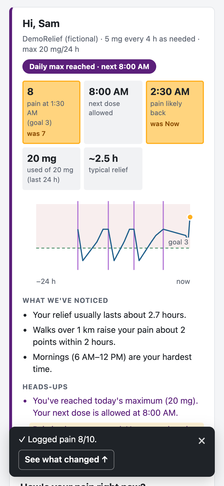

# PainTracker
PainTracker: a patient web app that learns your personal pain pattern and warns you before pain returns, always within your prescription limits. Built with React + Vite and powered by n8n workflows and a personalized ML model. Synthetic data only, not medical advice. UBC LOOP x n8n Buildathon 2026.

**Pain is personal, so your pain plan should be too.**

PainTracker is a patient web app that learns your personal pain pattern and gives you a heads-up *before* your pain comes back, always within your prescription limits.

**Live app:** https://pain-tracker-rosy.vercel.app (installable on your phone: *Add to Home Screen*)

> ⚠️ **Hackathon demo. Synthetic data only. Not medical advice.** All patients and medications in this project ("Baselinol", "DemoRelief") are fictional.

Built for the **UBC LOOP × n8n Buildathon** (Nov 14–15, 2026), n8n track.

| Your dashboard | Why this prediction | Log in a tap | Live updates |
|---|---|---|---|
|  |  |  |  |

---

## The problem

Pain is individual and changes hour to hour. Prescriptions for "as needed" pain medication are written with fixed rules (e.g. "every 4 hours"), but they can't account for when *your* pain tends to return, what makes it worse (activity, weather, missed meals, time of day), or how this changes over time. Patients often wait in pain, and prescribers rarely see these patterns.

## What PainTracker does

- 📝 **Quick logging:** pain score (0–10), "Took my dose" (with a confirm step), meals, walks, and physio appointments
- 🚶 **Automatic walk tracking:** while the app is open, walks are detected on the phone and logged as distance + minutes
- ⏱ **Prescription-aware status:** when your next dose is allowed, mg used of your 24 h maximum, and a clear "Daily max reached" state
- 💊 **My medication:** enter your prescription from the label (dose, hours between doses, daily max, pain goal); n8n validates it and applies the new limits right away
- 🔮 **Personal prediction:** "Your pain is likely back around 3:00 PM", with a dashed **forecast line** on the chart showing expected pain after your last dose
- 🩺 **Plan around physio:** add an appointment and the prediction updates right away (physio soon after a dose shortens relief)
- ❓ **Why this prediction:** shows what moved it, e.g. *Evening: 48 min sooner · Your personal pattern: 14 min later*
- 💡 **Your patterns:** e.g. "Walks over 1 km raise your pain about 2 points within 2 hours"
- 🔔 **Heads-ups in the app:** pain likely back soon, daily max reached, physio coming up
- 📈 **Live updates:** after every log, the dashboard refreshes and highlights what changed (new chart point, updated prediction, new heads-ups)
- 🧠 **Learns from you:** e.g. "Learned from 71 of your doses. Your pain returns about 14 min later than average."
- 🕒 **Demo clock (for demos only):** skip ahead +30 min / +1 h to show learning without waiting hours; always labelled "Demo time" while active

PainTracker **never suggests anything outside your prescription**. Predictions only change *when* you get a heads-up. n8n checks the dose interval and 24 h maximum on every dose and warns if a dose is too early.

## How it works

```
React web app (PWA) ──► n8n webhooks ──► rules · patterns · prediction · learning · storage
        ▲                POST /log, /prescription        │
        │                GET /dashboard                  │
        └──────────── reply + dashboard JSON ◄───────────┘
```

- **App (`app/`):** React + Vite, installable as a PWA, deployed on Vercel. It only displays data and collects input; there is no business logic in the app. All calls go through `app/src/api.js`.
- **n8n (`n8n/`):** all the logic, in workflows on n8n Cloud:
  - **B3 · Check rules & predict**: prescription rules (interval, 24 h max), patterns, and the model's prediction
  - **B4 · POST /log**: validates and saves pain, dose, meal, walk and physio entries; adds current weather (Open-Meteo); runs the rules and replies with a message and any warning; **learns** from each completed dose
  - **B6 · GET /dashboard**: everything the app's dashboard shows, including the forecast, the "why" factors and upcoming physio
  - **R4 · POST /prescription**: validates and saves the patient's medication limits
  - **R3 · POST /demo-clock**: shifts "now" for demos (labelled in the app)
  - **Setup**: creates the data tables and loads the demo patient
  - Storage: n8n Data Tables (`prescription`, `doses`, `pain_log`, `meals`, `walks`, `schedule`, `patient_model`, `predictions`, `demo_clock`)
- **Model (`ml/`):** a personalized linear regression (Ridge, scikit-learn) that predicts *hours until pain rises above your goal after a dose*. A per-patient offset is updated in n8n after every dose (`offset = 0.7 × offset + 0.3 × error`), so predictions adapt to each patient. Details: [`docs/MODEL.md`](docs/MODEL.md).
- **Data (`data/`):** synthetic dataset generator (30 fictional patients × 21 days).

### Model results (synthetic data; trained on days 1–16, tested on days 17–21)

| Model | Average error |
|---|---|
| Patient's own median (simple baseline) | 45 min |
| Linear, same for everyone | 38 min |
| **Linear + personal offset (PainTracker)** | **36 min** |

Biggest effects it found: evenings, physio soon after a dose, walking in the previous 3 h, pain level at the dose, and rain.

## Privacy & safety by design

- Location is used **only while the app is open**, with permission.
- Walk distance is calculated **on the phone**. Only `{ km, minutes }` is sent; coordinates are never sent or stored.
- Every screen shows: *"Feeling very drowsy or confused? Don't take more. Call 811 or your care team."* and *"Demo with synthetic data. Not medical advice."*
- Dose limits always come from the prescription. The model only changes the timing of heads-ups.

## Getting started

### Use it
Open https://pain-tracker-rosy.vercel.app on your phone and add it to your home screen. Turn on **Auto walk tracking** to try GPS walks.

### Run the app locally
Requires Node.js 20.19+ or 22.12+.

```bash
cd app
npm install
cp .env.example .env      # set VITE_N8N_URL (leave it unset to use built-in sample data)
npm run dev               # http://localhost:5173
```

Without `VITE_N8N_URL`, the app runs on sample data from [`docs/API.md`](docs/API.md) and says so in the header.

### Set up the n8n side
All workflows are exported in [`n8n/`](n8n/). Import them into n8n Cloud (**⋯ → Import from URL**), run **Setup** once, and activate the webhook workflows. Full steps in [`docs/N8N.md`](docs/N8N.md).

### Regenerate data and retrain
```bash
node data/generate.js     # synthetic history ending now
python ml/train.py        # → ml/weights.json + accuracy table
node n8n/build.js         # rebuild the n8n workflow files
```

## Project structure

```
PainTracker/
├── app/    React + Vite web app (PWA)
├── n8n/    n8n workflows (.json), Code-node sources, seed data
├── ml/     model training + exported weights
├── data/   synthetic data generator + dataset
└── docs/   API contract, n8n workflows, model, demo plan
```

## Data & limitations

- All data is **synthetic** and only reproduces the patterns we programmed into it. It shows the method works, not clinical accuracy.
- One as-needed pain medication per patient. The scheduled medication (Baselinol) comes from the demo history; the app doesn't log it yet.
- Physio appointments are entered in the app (no live calendar connection yet).
- The n8n webhooks have no login: fine for a demo with fictional data, but a real app would need patient accounts.
- Real-world use would require real, consented, de-identified data, clinical validation and regulatory review.

**Next steps:** survival analysis (uses doses where pain return wasn't observed), multiple medications, calendar sync for appointments, sharing summaries with a prescriber (with patient approval).

## Built with / disclosures

- [n8n](https://n8n.io) Cloud: workflows and Data Tables
- React + Vite (official `create-vite` React template)
- [vite-plugin-pwa](https://vite-pwa-org.netlify.app/): installable app
- [Vercel](https://vercel.com): hosting
- [Open-Meteo](https://open-meteo.com): weather data
- scikit-learn: model training
- [Claude Code](https://claude.com/claude-code) (Anthropic): coding assistant

## Team

- Reagan Chicoine
- Hamza Riaz
